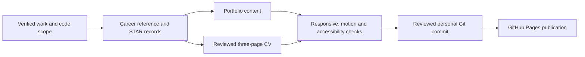

# Ahmed ElMahdy

## Portfolio Engineering

- Live portfolio: [ahmed-el-mahdy.github.io](https://ahmed-el-mahdy.github.io/)
- Safe update workflow: [PORTFOLIO-MAINTENANCE.md](PORTFOLIO-MAINTENANCE.md)
- Visual acceptance record: [design-qa.md](design-qa.md)
- Runtime: static GitHub Pages site; no build step or package installation required.

**Platform / DevOps Engineer**  
📍 New Cairo, Egypt  

> Cloud & DevOps Engineer focused on inherited-platform stabilization, controlled migrations, repeatable delivery, and workload-to-data troubleshooting across Azure and AWS.

🇬🇧 English — Professional Working | 🇪🇬 Arabic — Native

---

## 📊 At a Glance

| 6 AKS Backend Services | 2 App Service Portals | 18 Verified CSI Keys | 91,724 Blobs Replicated | 24 Historical Workflow Branches | 18 Promotion Checks |
|:-:|:-:|:-:|:-:|:-:|:-:|

Reviewed 30 October 2026 against the private career-evidence summary and canonical platform READMEs. Counts are dated implementation checkpoints, not current live inventory, uptime guarantees or tested regional recovery. The public summary is the [impact PDF](Ahmed%20Elmahdy%20Work%20Impact.pdf) served with the portfolio.

---

## 🎯 Core Competencies

### ☁️ Cloud & Infrastructure
Azure (AZ-104 trained, SC-300 certified) and AWS (SAA certified). AKS, APIM, App Gateway, Firewall, Key Vault, Entra ID, EC2, Lambda, VPC. Multi-subscription environment design and platform recovery.

### ⚙️ Containers & Orchestration
CKA training completed. Kubernetes operations, Kustomize overlays, environment-specific scaling, probes, immutable images and CSI-backed configuration; separate Helm/Argo CD examples demonstrate pull-based GitOps.

### 🏗️ Infrastructure as Code
Terraform (modules, state management, drift analysis, environment alignment). CloudFormation for AWS. Platform recovery through IaC stabilization and alignment.

### 🔄 CI/CD & Automation
GitHub Actions (GitLab migration), Jenkins, CircleCI. DRY pipeline patterns, secret-dependent workflows, multi-branch deployments, automated APIM imports.

### 🔒 Identity & Security
Azure Entra ID, scoped RBAC, Key Vault/CSI secret contracts, IAM roles, WAF policies and network-boundary validation. Pod security, image scanning and network policies are separate controls, not implied by perimeter security.

---

## 🛠️ Tech Stack

| Category | Technologies |
|----------|-------------|
| **Cloud** | Azure, AWS (SAA), Terraform, CloudFormation |
| **Containers** | Kubernetes, Docker, Helm, Argo CD, Kustomize |
| **CI/CD** | GitHub Actions, Jenkins, CircleCI, GitLab CI, Ansible |
| **Languages & Dev** | Bash/Shell, Python, C# / .NET 8, TypeScript, Angular, YAML, HCL |
| **Monitoring** | Prometheus, Grafana, CloudWatch, App Insights, Azure Monitor |
| **Systems & Networking** | Linux Admin, Windows Server, Active Directory, DNS/DHCP, VPN, Proxmox, VLANs, Firewalls, Nginx |

---

## 🏅 Certifications & Credentials

### ✅ Official Industry Certifications (Exams Passed)

| Certification | Issuer | Date |
|--------------|--------|------|
| **AWS Solutions Architect – Associate** | Amazon Web Services | 2025 — Expires Sep 2028 |
| **AWS Certified Cloud Practitioner** | Amazon Web Services | 2025 — Expires Sep 2028 |
| **Microsoft Identity & Access Administrator (SC-300)** | Microsoft | November 2025 |
| **McKinsey Forward Program** | McKinsey.org | 2025 |

### 🎯 Exam-Ready Training (Completed)

| Training | Provider | Status |
|----------|----------|--------|
| **CKA Certification Course** | KodeKloud (Mumshad Mannambeth) | March 2025 — Ready for CNCF exam |
| **Azure Administrator Associate (AZ-104)** | Manara | November 2025 — Ready for Microsoft exam |
| **Microsoft Identity & Access Admin Training** | Microsoft Learn | November 2025 |
| **Advanced Cloud DevOps Nanodegree** | Udacity & MCIT | 2023 |

### 📚 Additional Training

| Course | Issuer | Date |
|--------|--------|------|
| IT Security Foundations: Core Concepts | LinkedIn Learning | — |
| Network Virtualization Concepts | Broadcom (VMware IT Academy) | May 2022 |
| Cloud & Virtualization Concepts | Broadcom (VMware IT Academy) | May 2022 |
| Software Defined Storage Concepts | Broadcom (VMware IT Academy) | May 2022 |

---

## 💼 Professional Experience

### Platform/DevOps Engineer — Julfar Consultancy Services
**January 2026 – Present** | Cairo, Egypt

- Stabilized inherited Azure/Terraform platforms across DEV, STAGING, and PROD by resolving drift, state, and configuration risks
- Deliver client-platform work including Mosadad's six AKS backends, two App Service portals, and separate Functions and VM payment deployment paths
- Implemented end-to-end microservice onboarding for the ActionAI platform — GitHub repos, GitHub Actions CI/CD, Helm deployments, Argo CD post-sync automation
- Integrated secure delivery patterns: Azure Key Vault, Terraform-based secret governance, Azure/Entra group-based RBAC
- Modernized CI/CD by migrating pipelines from GitLab to GitHub Actions with validated workflow reliability
- Drove platform efficiency through Kubernetes autoscaling, capacity right-sizing, and cloud cost analysis
- Improved maintainability through READMEs, Confluence documentation, architecture diagrams, and stakeholder reporting
- Delivered isolated staging2 backend/API/portal phases with immutable images, direct-backend checks and service-by-service routing validation
- Replicated 91,724 blobs across three containers with exact name/size parity at the checkpoint, read-only source access and no-delete target permissions
- Verified the 18-key CSI contract and removed temporary operator access; standardized six backend workflows across four branches and validated 18 promotion merge paths at the recorded checkpoint

`Azure` `Terraform` `Kubernetes` `Helm` `Argo CD` `GitHub Actions` `APIM` `Key Vault` `Entra RBAC`

---

### Cloud & Systems Administrator — Julfar Consultancy Services
**October 2021 – December 2025** | Cairo, Egypt (4 years 4 months)

- Administered diverse infrastructure: Windows/Linux servers, AWS CloudFormation stacks, VDI environments
- Spearheaded DevOps practices: Infrastructure as Code, CI/CD pipeline automation
- Automated system configuration, deployments, and provisioning using Bash and Python
- Troubleshot complex network issues, maintained cloud security compliance
- Reduced manual configuration errors by 20% through automation
- Maintained 99.9% uptime through proactive monitoring

`AWS` `Linux` `Windows Server` `CloudFormation` `Bash` `Python` `VDI`

---

### DevOps Engineer Intern — Digital Egypt Pioneers Initiative (DEPI) — MCIT
**May 2024 – February 2025** | Cairo, Egypt

- Comprehensive DevOps training: Git, Ansible, Docker, Jenkins, Kubernetes, Prometheus
- AWS Cloud architecture, Terraform for infrastructure as code
- Delivered a client-facing 3-tier web application with automated infrastructure, CI/CD, autoscaling, and monitoring

`Docker` `Kubernetes` `Jenkins` `Terraform` `Ansible` `AWS` `Prometheus`

---

### Cloud DevOps Trainee — MCIT & Udacity
**November 2022 – April 2023** | Cairo, Egypt

- Six-month intensive program: AWS, CI/CD pipelines, IaC with Terraform & CloudFormation
- Delivered two client web applications: a static AWS site and a 3-tier application deployed through CircleCI
- Agile collaboration with mentors

---

### Infrastructure & Systems Engineer — Shatta Company
**March 2019 – February 2020** | Cairo, Egypt (1 year)

- Administered multi-OS environments, Proxmox clusters, VLANs, and firewalls
- Implemented VPN connections for secure multi-site connectivity
- Managed DNS, DHCP, Active Directory, and security systems
- Maintained 99.9% uptime through proactive monitoring

`Proxmox` `VLANs` `Firewalls` `VPN` `Active Directory` `Linux` `Windows`

---

## 🚀 Featured Projects

### ActionAI Platform Enablement (2026)
End-to-end onboarding of new microservices: repository setup, GitHub Actions CI/CD, Helm-based multi-environment deployment, Argo CD post-sync integration. Automated service exposure via Azure APIM endpoint registration. Strengthened secure delivery with Key Vault, Terraform secret governance, and Entra group-based RBAC.

`Azure` `GitHub Actions` `Helm` `Argo CD` `APIM` `Key Vault` `Entra RBAC`

### Mosadad Recovery Claims Platform (2026)
Recovered inherited Azure/Terraform configuration and delivered a parallel staging2 migration for six backend services and two portals. The September handoff records 18 CSI keys, six immutable backend digests and exact name/size parity for 91,724 application blobs. Production data modernization happened in distinct Cosmos DB MongoDB API RU/serverless and DocumentDB vCore stages, with firewall egress diagnosis and application-read validation. Historical workflow alignment covered six repositories and four branches, with 18 clean promotion dry-runs.

Authenticated staging2 UAT, notifications and final closure remained follow-ups. October staging2 NGINX source differs from the historical Gateway API handoff and requires controller-ownership reconciliation. Declared HA/replicas are not evidence of tested restore, regional failover, RPO or RTO.

`Azure AKS` `Terraform` `GitHub Actions` `Kubernetes` `.NET 8` `Kustomize` `MongoDB`

### Serverless Image Processing (2025)
Built an S3/Lambda image-processing reference project with configurable resizing and infrastructure examples; its educational scope is distinct from employer production outcomes.

### Portfolio Asset Sources

The Azure Block Blob and Cosmos DB SVGs are original Microsoft Azure architecture artwork distributed by the maintained [benc-uk icon collection](https://github.com/benc-uk/icon-collection/tree/master/azure-icons): `Blob-Block.svg` and `Azure-Cosmos-DB.svg`. Existing Microsoft, AWS, Devicon, Simple Icons and credential assets are retained. Lucide is used for interface actions and generic concepts, not invented product logos.

`AWS Lambda` `S3` `Python` `CloudFormation`

### N8N + Nginx + Ngrok Automation (2025)
Containerized workflow automation platform with reverse proxy, SSL, and automated ngrok URL synchronization for webhook continuity.

`Docker Compose` `Nginx` `Ngrok` `Shell` `n8n`

### [DevOps CI/CD Project — 3-Tier App (2024)](https://github.com/ahmed-el-mahdy/MCIT-DevOps-Project)
Automated deployment of a 3-tier application on AWS using Jenkins, Terraform, and EKS with auto-scaling and high availability.

`Jenkins` `Terraform` `EKS` `AWS` `Auto-scaling`

### Shell-Scripted Database Management System (2024)
CLI-based database management system built entirely with shell scripts for local data storage and query operations (DEPI & MCIT).

`Bash` `Shell Scripting` `Linux`

### [UdaPeople CI/CD App (2023)](https://github.com/ahmed-el-mahdy/udapeople-cicd)
Deployed a dynamic website using CloudFormation and CircleCI integrated with AWS services. Final graduation project for the DevOps Nanodegree.

`CloudFormation` `CircleCI` `AWS` `Ansible` `Prometheus`

### [AWS Infrastructure Automation (2022)](https://github.com/ahmed-el-mahdy/CloudFormation-Project2)
Provisioned a highly available AWS web application using reusable CloudFormation network and server templates.

`CloudFormation` `S3` `AWS`

---

## 🎓 Education

| Degree | Institution | Period |
|--------|------------|--------|
| **B.Sc. Computer Science** | Delta University for Science & Technology | 2014–2018 \| GPA: 3.7 |
| **ITI Diploma — Network & System Administration** | Information Technology Institute | October 2018 – January 2019 |

---

## 📬 Let's Connect

Open to **Senior DevOps / Platform Engineer / Cloud Architect** roles  
Remote, UAE, KSA, or Egypt-based

- 📧 [a.elmahdy.mail@gmail.com](mailto:a.elmahdy.mail@gmail.com)
- 🐙 [GitHub](https://github.com/ahmed-el-mahdy)
- 💼 [LinkedIn](https://www.linkedin.com/in/ahmed-el-mahdy-007/)
- 🏅 [Certifications (Credly)](https://www.credly.com/users/ahmed-el-mahdy-mohammad/badges)

---

*© 2026 Ahmed ElMahdy — Platform Engineer | AWS SAA • SC-300 | CKA study paused • AZ-104 training completed*

## Evidence and Publication Flow

The public portfolio separates dated employer/client outcomes from personal reference implementations and team/training work. Private employment transitions, immigration details, raw history and confidential configuration belong outside public repositories. Career evidence and STAR stories are maintained in a private repository; the public summary is the portfolio page and its impact PDF.

Review gates are independent: source accuracy, document formatting, static links/assets, browser behavior and deployed-page verification. A successful local page render is not proof of a successful Pages deployment. Current CKA review is paused at maintenance/certificates; historical course completion is not exam readiness or certification.
